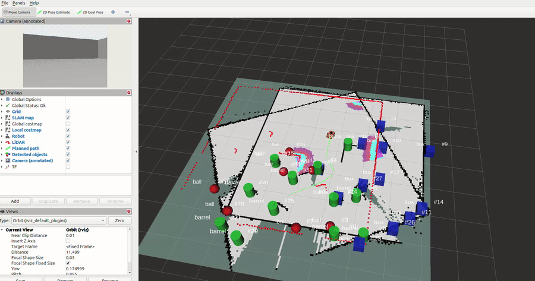
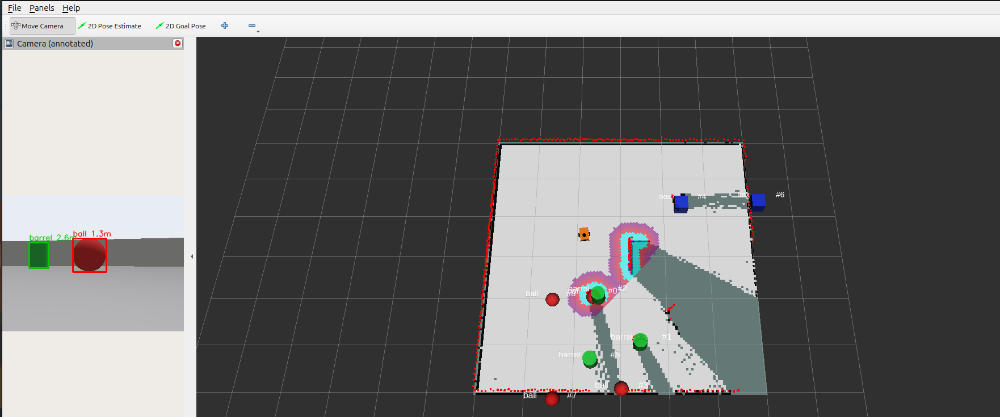
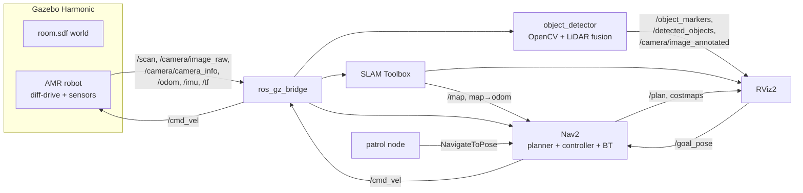

# Autonomous Mobile Robot (ROS 2 Jazzy + Gazebo Harmonic)

A differential-drive robot that **maps an unknown room, navigates autonomously and detects objects**, entirely in simulation. Built with ROS 2 Jazzy, Gazebo Harmonic, SLAM Toolbox, Nav2 and OpenCV.





## Features

- **Robot model** (xacro/URDF): differential drive, 2D LiDAR, RGB camera, IMU.
- **Gazebo world:** a 6 m × 6 m room with walls, obstacles and coloured objects to find.
- **SLAM:** SLAM Toolbox builds the map online while the robot drives.
- **Autonomous navigation:** Nav2 (NavFn planner + Regulated Pure Pursuit controller). Click a goal in RViz2 or run the built-in waypoint patrol.
- **Object detection:** OpenCV colour segmentation on the camera image, fused with LiDAR range, so every detected object is **placed on the map** as a labelled 3D marker.
- **One-command launch** and a ready-made RViz2 layout.
- **Optional YOLO node** for people with more RAM / a GPU.

## Architecture



### TF tree

```
map ──(SLAM Toolbox)──> odom ──(Gazebo diff-drive)──> base_footprint ──> base_link
                                                                          ├── left_wheel / right_wheel
                                                                          ├── front_caster / rear_caster
                                                                          ├── lidar_link
                                                                          ├── camera_link ──> camera_optical_link
                                                                          └── imu_link
```

### How object detection works

1. `find_blobs()` converts the image to HSV and thresholds red, green and blue regions.
2. The blob centre column and the camera intrinsics (`/camera/camera_info`) give a **bearing angle**.
3. The LiDAR range at that bearing gives the **distance**.
4. The resulting point is transformed into the `map` frame with TF.
5. Repeated sightings are merged by an `ObjectTracker` (running average); an object appears after `min_hits` sightings.

Colour → class mapping used in the demo world: red sphere = **ball**, blue cubes = **box**, green cylinder = **barrel** (configurable in `amr_perception/config/detector.yaml`).

Known simplification: the camera and LiDAR are assumed to share the same bearing (their mounting offset is ~11 cm, which is negligible beyond ~1 m).

## Packages

| Package | Type | Purpose |
|---|---|---|
| `amr_description` | ament_cmake | Robot xacro/URDF |
| `amr_gazebo` | ament_cmake | World, `ros_gz` bridge config, simulation launch |
| `amr_perception` | ament_python | Object detector (+ optional YOLO), unit tests |
| `amr_navigation` | ament_python | SLAM + Nav2 config/launch, waypoint patrol |
| `amr_bringup` | ament_cmake | Top-level launch + RViz2 config |

## Requirements

- Ubuntu 24.04, **ROS 2 Jazzy**, **Gazebo Harmonic** (installed with `ros-jazzy-ros-gz`)
- ~6 GB RAM recommended (runs in a VM with 6 GB; see [Performance tips](#performance-tips))

```bash
sudo apt update
sudo apt install -y ros-jazzy-navigation2 ros-jazzy-nav2-bringup \
  ros-jazzy-nav2-simple-commander ros-jazzy-slam-toolbox \
  ros-jazzy-xacro ros-jazzy-robot-state-publisher \
  ros-jazzy-ros-gz python3-numpy python3-opencv
```

## Build

```bash
cd ~/ros2_ws/src
git clone https://github.com/Mrmoha01/autonomous_mobile_robot.git
cd ~/ros2_ws
rosdep install --from-paths src --ignore-src -r -y
colcon build --symlink-install
source install/setup.bash
```

## Run

**Everything at once** (Gazebo, SLAM, Nav2, detector, RViz2):

```bash
ros2 launch amr_bringup bringup.launch.py
```

Then, in RViz2, press **2D Goal Pose**, click a spot in the room and drag to set the heading. The robot plans a path and drives there while building the map. Detected objects appear as coloured markers with labels, and the annotated camera view shows the detections.

**Autonomous patrol** (no clicking; loops through four waypoints):

```bash
ros2 launch amr_bringup bringup.launch.py patrol:=true
```

**Launch options**

| Argument | Default | Meaning |
|---|---|---|
| `gui` | `true` | Show the Gazebo window (`false` = server only, saves RAM) |
| `rviz` | `true` | Start RViz2 |
| `patrol` | `false` | Start the waypoint patrol |
| `yolo` | `false` | Also run the optional YOLO node |

**Drive manually** (teleop):

```bash
ros2 run teleop_twist_keyboard teleop_twist_keyboard
```

**Save the map:**

```bash
ros2 run nav2_map_server map_saver_cli -f ~/ros2_ws/src/autonomous_mobile_robot/amr_navigation/maps/room
```

**Run the unit tests** (no ROS needed):

```bash
cd amr_perception && python3 -m pytest -q
```

## Useful topics

| Topic | Type | Description |
|---|---|---|
| `/scan` | `sensor_msgs/LaserScan` | 360° LiDAR, 8 m range |
| `/camera/image_raw` | `sensor_msgs/Image` | 320×240 RGB camera |
| `/camera/image_annotated` | `sensor_msgs/Image` | Camera image with detection boxes and ranges |
| `/object_markers` | `visualization_msgs/MarkerArray` | Detected objects on the map |
| `/detected_objects` | `std_msgs/String` | JSON list of objects (`label`, `x`, `y`, `hits`) |
| `/map` | `nav_msgs/OccupancyGrid` | SLAM map |
| `/cmd_vel` | `geometry_msgs/Twist` | Velocity command |
| `/odom` | `nav_msgs/Odometry` | Wheel odometry |

## Performance tips

- Launch with `gui:=false` to skip the Gazebo window, or `rviz:=false` if RViz2 is slow.
- In a VM, software rendering can help: `export LIBGL_ALWAYS_SOFTWARE=1` before launching.
- Camera (320×240 @ 10 Hz) and LiDAR (360 beams @ 10 Hz) are deliberately small. Increase them in `amr_description/urdf/amr.urdf.xacro` if you have more resources.
- Physics runs at a 4 ms step (`amr_gazebo/worlds/room.sdf`).

## Troubleshooting

| Problem | Try |
|---|---|
| No `/scan` or camera topics | Check `ros2 topic list`. Sensors need GPU/OpenGL rendering in Gazebo; try `LIBGL_ALWAYS_SOFTWARE=1`. |
| Robot does not move | `ros2 topic echo /cmd_vel`; check the bridge is running (`ros2 node list`). |
| Nav2 prints "timed out waiting for transform" at start | Normal for a few seconds until SLAM publishes `map → odom`. |
| Objects never appear | Check `ros2 topic echo /camera/image_annotated` in RViz2, and the `target_frame` parameter. |
| Gazebo does not start | Run `gz sim --version` (should print 8.x) and `source /opt/ros/jazzy/setup.bash`. |


## License

MIT, see [LICENSE](LICENSE).

## Author

**Mohammed Al Jaf**, [github.com/Mrmoha01](https://github.com/Mrmoha01)
